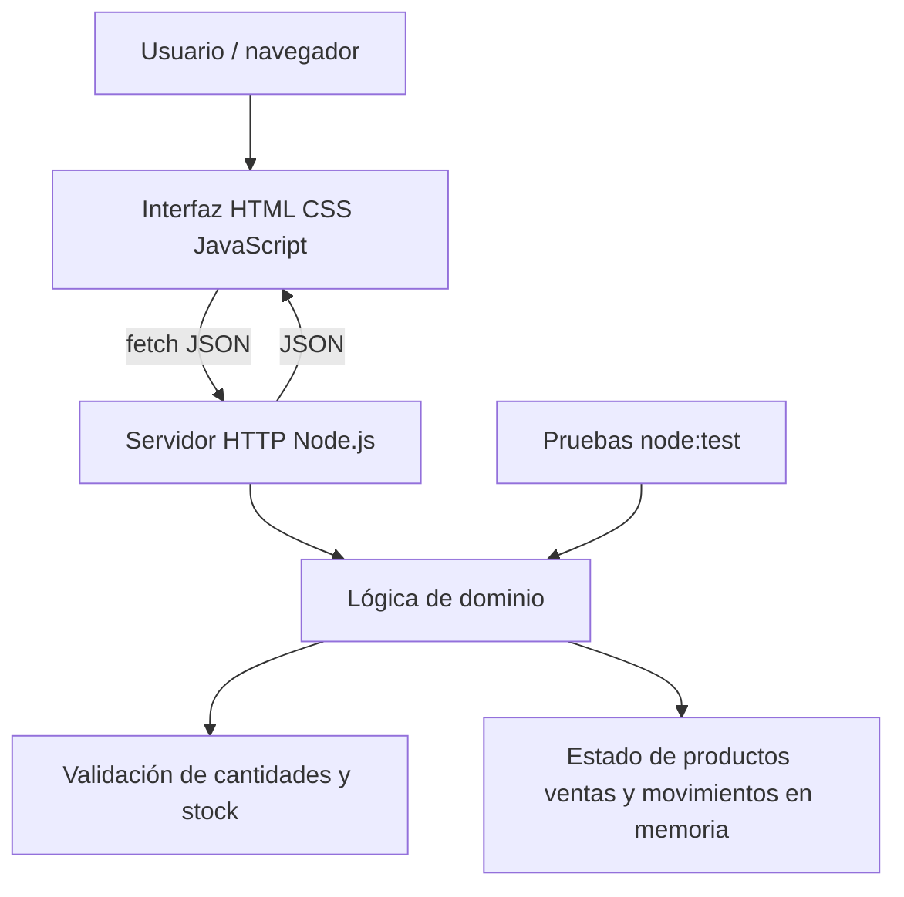

<div align="center">

# Net-Gestión · Demo académica

### Panel de ventas, stock e inventario


**Autor:** Emanuel Paz · [Portfolio](https://emanuel-paz-portfolio.vercel.app/) · [LinkedIn](https://www.linkedin.com/in/emapaz05/)

</div>

> **Importante:** este es un **prototipo didáctico nuevo e independiente**, inspirado en los procesos de gestión de un comercio. No es el código del producto comercial Net-Gestión, no usa datos de clientes, no se conecta a las bases de datos de producción y no pretende incluir todas las funcionalidades del producto real.

## Segundo entregable del coloquio: automatización de reportes

**[Abrir automatización ejecutable de reportes por correo](./automatizacion-reportes/README.md)**

Es una aplicación independiente en `automatizacion-reportes/`, con código Node.js, datos de ventas ficticias, generación automática de reportes JSON/HTML, pruebas y envío opcional por Resend. No es el código real de Net-Gestión.

```bash
cd automatizacion-reportes
npm start -- --date=2026-11-11
npm test
```

> Para cumplir literalmente la consigna de **dos repositorios fijados**, esta carpeta todavía debe publicarse como repositorio GitHub separado. Aquí ya está lista y publicada como módulo ejecutable.

## Problema y solución

Los comercios necesitan registrar movimientos y conocer su stock para evitar errores operativos. Esta aplicación muestra un flujo completo y reproducible: crear productos, registrar ventas, descontar existencias, ingresar mercadería y visualizar indicadores.

## Funcionalidades implementadas

- Panel con ventas totales de demostración, número de productos, unidades disponibles y alertas de stock bajo.
- Catálogo de productos con precio, categoría, stock actual y mínimo.
- Alta de productos con validaciones.
- Registro de ventas con control de existencias y cálculo del importe.
- Ingreso de mercadería y actualización de existencias.
- Historial simplificado de movimientos.
- Restablecimiento de los datos ficticios.
- Diseño responsive, utilizable en escritorio y dispositivos móviles.

## Cómo ejecutarlo

**Requisito:** Node.js 18 o superior. No hay servicios externos, claves de API ni dependencias npm que instalar.

```bash
git clone https://github.com/EmanuelPaz05/Sistema-de-Gestion-de-Stock-para-Negocios.git
cd Sistema-de-Gestion-de-Stock-para-Negocios
npm start
```

Abrí **http://localhost:3000** en tu navegador.

Para ejecutar las pruebas:

```bash
npm test
```

Para desarrollo con reinicio automático del servidor:

```bash
npm run dev
```

## Arquitectura



### Organización del código

```text
.
├── public/
│   ├── index.html       # Interfaz y formularios
│   ├── styles.css       # Diseño responsive
│   └── app.js           # Renderizado y llamadas a API
├── src/
│   └── domain.js        # Reglas de negocio y estado de ejemplo
├── tests/
│   └── domain.test.js   # Pruebas de venta, validaciones y stock
├── server.js            # Servidor HTTP y rutas
└── package.json         # Scripts de ejecución
```

La separación entre UI, API y reglas de negocio permite demostrar responsabilidades de cada capa sin usar servicios privados.

### API

| Método | Ruta | Descripción |
| --- | --- | --- |
| GET | `/api/health` | Verificar estado |
| GET | `/api/state` | Productos, ventas, movimientos y métricas |
| POST | `/api/products` | Crear producto |
| POST | `/api/sales` | Registrar venta y descontar stock |
| POST | `/api/restocks` | Aumentar existencias |
| POST | `/api/reset` | Restablecer datos ficticios |

Ejemplo de venta:

```bash
curl -X POST http://localhost:3000/api/sales \
  -H "Content-Type: application/json" \
  -d '{"productId":1,"quantity":2}'
```

Si la cantidad excede las existencias, la API responde con un error de validación.

## Demostración sugerida para el coloquio (90 segundos)

1. Mostrar los indicadores del panel.
2. Registrar una venta, indicando el producto y cantidad.
3. Enseñar cómo disminuyen las existencias y aumentan los ingresos.
4. Intentar vender más unidades de las disponibles y explicar la validación.
5. Ingresar mercadería y revisar los movimientos registrados.

## Datos, alcance y limitaciones

- Todos los artículos, movimientos, precios y cifras de esta demo son **ficticios**.
- El estado vive **en memoria**: reiniciar el servidor restaura los datos de muestra.
- No implementa autenticación, cobros reales, facturación fiscal, multiempresa ni persistencia de producción.
- **No es una réplica del código ni de la arquitectura interna** del producto comercial Net-Gestión.
- No está alojada como aplicación web pública; se puede ejecutar localmente con Node.js.
- Se incluyen pruebas unitarias con el módulo estándar `node:test`.

## Referencia al proyecto comercial

El portfolio explica el caso real de Net-Gestión, mientras que este repositorio permite explorar un subconjunto ilustrativo de procesos con código público: [Ver caso de estudio](https://emanuel-paz-portfolio.vercel.app/proyectos/netgestion.html).

---

### Capturas de referencia de trabajos anteriores de gestión comercial

Las imágenes siguientes estaban en la versión previa de este repositorio. **No corresponden a la nueva demo ejecutable** y se conservan únicamente como referencia visual de trabajos anteriores.


