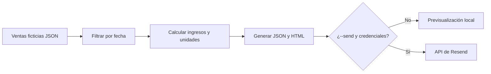

# Automatización de reportes comerciales — Net-Gestión (demo)

**Proyecto de automatización para coloquio | Emanuel Paz | Node.js 18+**

> Reimplementación educativa, autónoma y con datos ficticios de un tipo de proceso que Emanuel desarrolló para Net-Gestión: la generación y el envío automatizado de reportes comerciales por correo. **No contiene código de producción** y no se conecta a Gmail, clientes ni bases reales. Ofrece una **integración opcional de prueba con Resend** usando credenciales propias, desactivada por defecto.

## Problema que resuelve

Preparar manualmente un reporte de ventas, calcular resultados y enviarlo por correo consume tiempo y puede causar errores. Esta demo automatiza el flujo a partir de un conjunto de ventas de ejemplo:



## Arquitectura

- `data/ventas.json`: fuente ficticia, sin datos de clientes.
- `src/report.js`: validación, filtrado por fecha, cálculo de totales y plantillas HTML/texto.
- `src/transport.js`: simulación segura por defecto o envío opcional mediante API de Resend.
- `src/cli.js`: orquestación, archivos de salida y ejecución programada opcional cada N minutos.
- `tests/report.test.js`: tests de filtros, cálculos, validaciones, escapado HTML y envío simulado.

## Instalación

**Requisitos:** Node.js 18 o superior. No es necesario instalar paquetes externos.

Desde la raíz del repositorio de Net-Gestión Demo:

```bash
cd automatizacion-reportes
npm start -- --date=2026-11-11
```

El programa genera `output/reporte.json` y `output/reporte.html`. Abrí el archivo HTML en el navegador para mostrar el correo. **No envía ningún email real**.

Ejecutar pruebas:

```bash
npm test
```

### Automatización periódica

```bash
npm run watch -- --date=2026-11-11
```

En modo demostración, genera el reporte al iniciar y nuevamente cada minuto (se puede ajustar mediante `DEMO_INTERVAL_MINUTES`). El programa debe permanecer abierto. Si no se indica fecha, utiliza la fecha UTC actual. **No pretende replicar la programación de producción de Net-Gestión.**

### Envío real opcional por Resend

Sólo para una cuenta y dominio de pruebas controlados por vos:

```bash
# Linux / macOS
export RESEND_API_KEY="tu_clave_de_prueba"
export REPORT_FROM="Demo <demo@tu-dominio-verificado>"
export REPORT_TO="tu-correo-de-prueba@ejemplo.com"
node src/cli.js --date=2026-11-11 --send
```

No uses direcciones de terceros, certificados de ARCA, claves reales de clientes ni tokens de producción. Las variables son **sólo locales**, nunca deben subirse a GitHub. La API puede aceptar un envío sin que eso confirme entrega efectiva. Si no activás `--send`, no se hace ninguna solicitud externa.

## Demo en 60 segundos

1. Abrir `data/ventas.json` y mostrar cinco operaciones ficticias.
2. Ejecutar `npm start -- --date=2026-11-11`.
3. Mostrar el cálculo de ventas y los archivos generados.
4. Abrir `output/reporte.html`, mostrando el mensaje ya armado sin intervención manual.
5. Mostrar cómo se puede programar con `npm run watch -- --date=2026-11-11`.

## Relación con el producto real

En [Net-Gestión](https://netgestion.ar/) también se desarrollaron integraciones con ARCA, Tiendanube y reportes por Gmail/Resend. Este repositorio **sólo** demuestra de forma independiente la automatización de generación de reportes y un transporte opcional de Resend. No afirma que su arquitectura, proveedor, programación o código sean iguales a los del producto comercial.

**Autor:** Emanuel Paz · [Portfolio](https://emanuel-paz-portfolio.vercel.app/) · [Guía del coloquio](https://github.com/EmanuelPaz05/EmanuelPaz05/blob/main/COLOQUIO.md)
