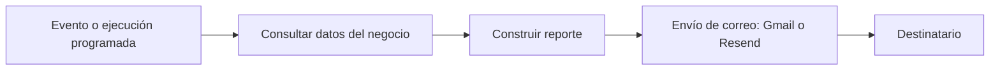

# Automatizaciones reales de Net-Gestión — Caso de estudio

**Autor:** Emanuel Paz · **Producto comercial:** [netgestion.ar](https://netgestion.ar)

> Esta página es **documentación de experiencia profesional**, no el código de producción. Los procesos aquí enumerados fueron indicados por su desarrollador. Los detalles técnicos no comprobados se marcan como pendientes de documentar. No hay credenciales, información fiscal ni datos de clientes.

## Integraciones y procesos que desarrollé en Net-Gestión

| Integración | Finalidad o área | Información a completar antes de la presentación |
| --- | --- | --- |
| **ARCA** | Integración con facturación electrónica | Cómo se solicita/comunica el comprobante, qué devuelve ARCA y cómo se manejan los errores |
| **Tiendanube** | Integración con comercio electrónico | Qué datos se sincronizan, qué evento dispara la sincronización y cómo se evitan duplicados |
| **Gmail** | Envío automático de reportes | Qué reporte se envía, quién lo recibe, con qué frecuencia y cuál es su disparador |
| **Resend** | Servicios de correo transaccional/automatizado | Qué mensajes salen por Resend y en qué casos se utiliza frente a Gmail |

El objetivo del coloquio es **describir una automatización que realmente conozca y pueda demostrar**, no afirmar que todas cumplen los mismos pasos.

## Caso de automatización recomendado: reportes por correo

**Problema que aborda:** evitar que una persona tenga que preparar y enviar reportes de gestión manualmente.

**Flujo conceptual a validar con la implementación real:**

**Preguntas para completar una demostración fiel al código real:**
1. ¿Se ejecuta por horario, cierre de caja, solicitud manual u otro disparador?
2. ¿Qué datos contiene el reporte: ventas, caja, stock o métricas?
3. ¿Se utiliza Gmail, Resend o ambos en flujos distintos?
4. ¿Qué ocurre si falla el envío? ¿Hay reintentos, avisos o registros?
5. ¿Se puede demostrar usando un comercio ficticio y una cuenta de prueba?

## Otros casos posibles

### Facturación ARCA

El valor profesional está en conectar el flujo comercial con el proceso de facturación. Para documentar correctamente el sistema faltan la secuencia real de solicitudes y respuestas, el entorno utilizado y el tratamiento de errores. **No publicar certificados ni datos fiscales**.

### Tiendanube

La integración con e-commerce puede ser un caso fuerte de automatización si se muestra una sincronización real. Se deben confirmar entidades, dirección del flujo y disparadores concretos antes de dibujar su arquitectura.

## Seguridad y límites de publicación

- El repositorio de demostración pública usa datos ficticios y una implementación independiente.
- No subir tokens de Tiendanube, credenciales de correo, contraseñas, certificados de ARCA ni datos identificables de clientes.
- Evitar capturas con CUIT, correos de terceros, pedidos o facturación reales.
- Para una demo académica, usar datos sintéticos y simular respuestas de servicios externos cuando corresponda.
- Este documento **no asegura** que las integraciones puedan ejecutarse desde este repositorio.

## Recursos del coloquio

- [Demo académica del proyecto grande](../README.md)
- [Portfolio profesional](https://emanuel-paz-portfolio.vercel.app/)
- [Producto comercial](https://netgestion.ar/)
